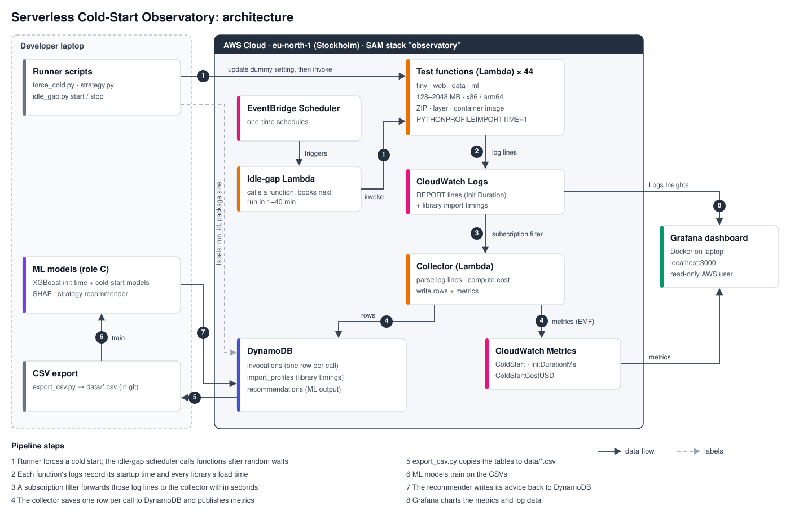

# Serverless Cold-Start Observatory

When an AWS Lambda function hasn't run for a while, AWS has to start it from
scratch before it can answer: create a fresh environment, start Python, load
the libraries. This is a **cold start**. Users wait for it, and AWS bills for it.

This project **measures** cold starts, **explains** what causes them, **prices**
them, and **recommends** the cheapest fix for each function:

| Fix | What it does | Trade-off |
|---|---|---|
| On-demand (do nothing) | Cold starts happen when they happen | Cheapest; users sometimes wait |
| SnapStart | AWS restores a saved snapshot instead of starting from scratch | Faster start; small extra cost |
| Provisioned concurrency | Copies are kept warm at all times | No waiting; costs the most |

Proposal: [docs/proposal.pdf](docs/proposal.pdf) · Report: [docs/REPORT.md](docs/REPORT.md) ·
Task list: [docs/TASKS.md](docs/TASKS.md) · Data columns: [docs/data_contract.md](docs/data_contract.md)

## Results

Median cold-start time, from 30 forced cold starts per function:

| Test function | Libraries it loads | x86 | arm64 |
|---|---|---|---|
| `tiny` | none | ~78 ms | ~68 ms |
| `web` | requests, jinja2, pydantic | ~500 ms | ~445 ms |
| `data` | pandas | ~2,050 ms | ~1,785 ms |
| `ml` | scikit-learn | ~3,500–4,100 ms | ~3,450 ms |

- **Libraries are the main cause.** Importing pandas alone takes 1.3–1.6 s.
- **More memory barely helps.** Startup time is about the same from 256 MB to 2 GB.
- **arm64 is 10–15% faster** to start, and about 20% cheaper.
- **Container images start about 3× faster than ZIP** for `data` on x86 (~700 ms vs ~2,080 ms).
- **SnapStart cuts `data` from ~2,080 ms to ~560 ms**, but doesn't help small functions like `web`.
- **Lambda recycles idle functions quickly:** half of the calls after a 1-minute pause were cold, and every call after 10 minutes or more.

**What the models found:**
- **Startup-time model (Model A):** typically within **4.4%** of the measured value for a function it has never seen.
- **Cold-start model (Model B):** a cold start becomes more likely than not after about 1.6 minutes idle.
- **The recommender:**
  - **Busy functions** (a call every few seconds or more often) should stay **on-demand**.
  - **Quiet, heavy functions** need **SnapStart** (for a 1 s target) or **provisioned concurrency** (for 500 ms).

Details: [docs/REPORT.md](docs/REPORT.md).

## Architecture

Everything runs in one AWS account, in the Stockholm region (`eu-north-1`).



PNG version for slides and the report: [docs/architecture.png](docs/architecture.png).

| Part | AWS service | Job |
|---|---|---|
| Test functions | Lambda | 4 workloads × memory sizes × chip types × packaging = 44 functions that only load libraries |
| Runner | Python scripts on your laptop | Force cold starts and label each call |
| Idle-gap scheduler | Lambda + EventBridge Scheduler | Calls functions after random waits (1–40 min), to learn when AWS shuts idle ones down |
| Logs | CloudWatch Logs | AWS writes each call's startup time; Python writes each library's load time |
| Collector | Lambda | Reads those log lines, works out the cost, saves the results |
| Storage | DynamoDB | The measured data and the recommendations (three tables) |
| Metrics | CloudWatch metrics | Cold-start count, startup time and cost, for charts |
| Dashboard | Grafana in Docker | Charts of everything above |
| ML | Python (XGBoost, SHAP, scikit-learn) | Predicts startup time and cold-start chance; recommends a fix |

All the AWS parts are created by one template (AWS SAM), deployed as the stack `observatory`.

## Pipeline, step by step

The numbers match the diagram.

1. **Force a cold start.** `runner/force_cold.py` changes a dummy setting on a test
   function. AWS throws away the warm copy, so the next call starts from scratch.
   The runner then calls the function and saves labels for that call: which
   experiment it belongs to, and the package size.
2. **The function logs its startup.** AWS writes a `REPORT` line with the startup
   time (`Init Duration`), billed time and memory used. Python writes one line per
   library with its load time.
3. **Logs are forwarded.** A subscription filter on each function's logs sends
   those lines to the collector within seconds.
4. **The collector saves the results.**
   - **`invocations` table:** one row per call (startup time, duration, memory,
     cost, cold or warm), merged with the runner's labels.
   - **`import_profiles` table:** the slow libraries per function.
   - **CloudWatch metrics:** for the dashboard.
5. **Export.** `scripts/export_csv.py` copies the tables to `data/*.csv`, which is in git.
6. **ML.** The models train on the CSVs.
7. **Recommendations.** The recommender writes its advice to the `recommendations` table.
8. **Dashboard.** Grafana charts the metrics and log data.

**Check the whole pipeline in one command:** `python scripts\demo_pipeline.py`
forces fresh cold starts and prints the output of every step.

## The data

| Where | What |
|---|---|
| `data/invocations.csv` | One row per call: about 1,900 rows. Filter on `run_id` to pick an experiment. |
| `data/import_profiles.csv` | Load time of each library per function: about 16,000 rows |
| `ml/notebooks/` | Model outputs: metrics, figures, recommendations |
| DynamoDB (AWS) | The live master copy of the measurements, plus `recommendations` |

| Experiment (`run_id`) | What was measured |
|---|---|
| `core-sweep-20261019` | 44 functions × 30 forced cold starts |
| `idle-gap-20261019` | 450 calls after random 1–40 min waits: does the function start cold? |
| `snapstart-20261019` | `web` and `data` with SnapStart: 30 restores each |

Every measurement is real, copied from AWS's own log lines. ML handover: [docs/HANDOVER_ML.md](docs/HANDOVER_ML.md).

## Repo layout

| Folder | What's inside |
|---|---|
| `workloads/` | The 4 test functions: `tiny`, `web`, `data`, `ml` |
| `infra/` | `generate_template.py` (builds the SAM template), `account-setup.yaml` (team logins) |
| `collector/` | The collector Lambda |
| `runner/` | `force_cold.py`, `idle_gap.py`, `strategy.py` (SnapStart / provisioned concurrency) |
| `scripts/` | Export, demo, account check, budget, cost check, publish recommendations |
| `ml/` | Prices, cost model, Model A, Model B, recommender, figures (outputs in `ml/notebooks/`) |
| `dashboards/` | Grafana setup and dashboard |
| `data/` | The exported CSVs |
| `tests/` | Collector tests: `python tests\test_collector.py` |
| `docs/` | Proposal, report, tasks, data contract, team access, ML handover, diagram |

Test functions are named `{workload}-{memory}-{chip}-{packaging}`, for example `data-512-arm64-zip`.

## Team

| Role | Owns | Status |
|---|---|---|
| **A: Infra & experiments** | Test functions, template, runner, idle-gap scheduler | Done |
| **B: Data pipeline & dashboard** | Collector, tables, metrics, Grafana | Done |
| **C: ML & analysis** | Models, SHAP, recommender, report figures | Done; publishing to Grafana next |

Everyone has their own login to the shared AWS account. **Teammates: follow
[docs/TEAM_ACCESS.md](docs/TEAM_ACCESS.md).**

## How to run it

**You need:** your AWS login set up with `aws configure` (region `eu-north-1`),
the [AWS CLI](https://aws.amazon.com/cli/), the
[SAM CLI](https://docs.aws.amazon.com/serverless-application-model/latest/developerguide/install-sam-cli.html),
Python 3.11+ (`pip install boto3 pyyaml`), and Docker Desktop (running).

**Deploy** (already done; only needed after code changes):
```cmd
python infra\generate_template.py --matrix full
cd infra
sam build
sam deploy
```

**Run experiments:**
```cmd
python runner\force_cold.py --all --samples 30 --threads 6
python runner\idle_gap.py start --functions web-512-arm64-zip data-512-arm64-zip
python runner\idle_gap.py stop
python runner\strategy.py snapstart --functions data-512-x86-zip --samples 30 --burst 1
```
Keep `--threads` at 6 or below. The account allows only 10 functions to run at once.

**Export the data**, then commit `data/`:
```cmd
python scripts\export_csv.py
```

**Run the ML analysis** (no AWS needed until the last two commands):
```cmd
pip install -r ml/requirements.txt
cd ml
python figures.py                     &:: arch / memory / packaging / SnapStart / import figures
python model_init.py                  &:: Model A: startup time (XGBoost p50/p90, GroupKFold, SHAP)
python model_cold.py                  &:: Model B: chance of a cold start vs idle time
python recommender.py                 &:: strategy per function, all scenarios -> ml/notebooks/*.csv
python recommender.py --write         &:: + DynamoDB `recommendations` (1000 ms, 0.1 req/s by default)
cd ..
python scripts\publish_recommendations.py
```
All outputs go to `ml/notebooks/`. `python ml/mock_data.py` makes a fake dataset for
testing; it refuses to overwrite the real export.

**Open the dashboard** at http://localhost:3000. It reads AWS with the profile in `GRAFANA_AWS_PROFILE`
(default: `observatory-grafana`).
```cmd
docker compose -f dashboards/docker-compose.yml up -d
```

## Cost

- **The account is on AWS's Free plan with credits.** Charges come out of the credits, not a card.
- `python scripts\check_running.py` lists anything that costs money while idle. Run it after experiments.
- **Each dashboard load costs a little.** It reads about 1 GB of logs; 5 GB a month are free. Auto-refresh is off, so close the tab when done.
- **SnapStart and provisioned concurrency are billed by the hour.** `strategy.py` switches them off after each run.

**To delete everything** (after grading, and after exporting the data):
```cmd
python runner\idle_gap.py stop
python scripts\export_csv.py
cd infra
sam delete --stack-name observatory
```
This also deletes the DynamoDB tables. The team logins (`observatory-account` stack)
and the budget are deleted separately in the AWS console.
